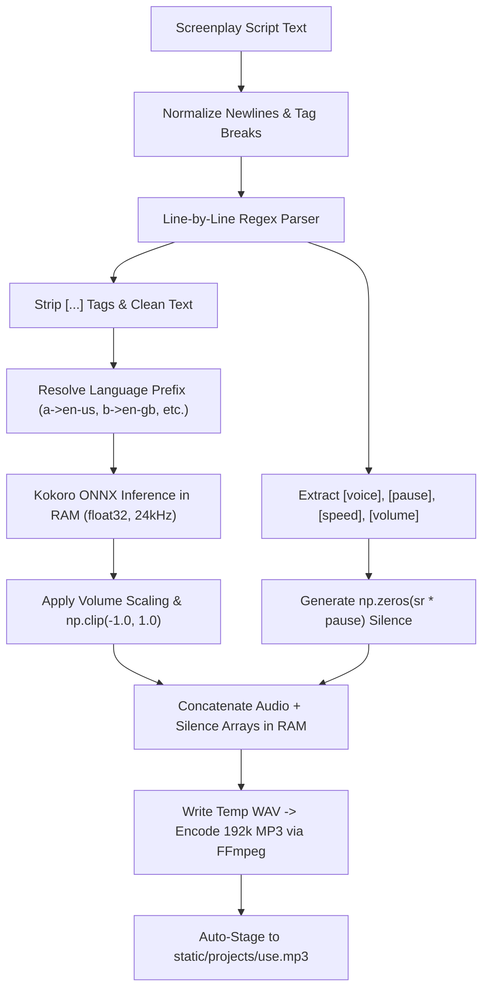

# 🎙️ Kokoro Power Demonstration & Multi-Voice Screenplay Guide

> **Generated Output**: [`kokoro_power_demo.mp3`](file:///home/jack/Desktop/Media_Studio/kokoro_power_demo.mp3)  
> **Duration**: 74.17 seconds &bull; **Audio Quality**: 192 kbps MP3 &bull; **Engine**: Native Kokoro ONNX on CPU (AMD Ryzen)  
> **Staged Locations**:  
> &bull; Root: [`/home/jack/Desktop/Media_Studio/kokoro_power_demo.mp3`](file:///home/jack/Desktop/Media_Studio/kokoro_power_demo.mp3)  
> &bull; Web Voice Archive: [`/home/jack/Desktop/Media_Studio/static/voice/kokoro_power_demo.mp3`](file:///home/jack/Desktop/Media_Studio/static/voice/kokoro_power_demo.mp3)  
> &bull; Avatar Lipsync Staging: [`/home/jack/Desktop/Media_Studio/static/projects/use.mp3`](file:///home/jack/Desktop/Media_Studio/static/projects/use.mp3)  

---

## 🌟 1. Overview

`kokoro_power_demo.mp3` is a production showcase of Media Studio's self-contained **Kokoro Neural TTS & Pause Engine**. In a single audio file, five distinct neural voice actors conduct a natural conversation demonstrating:

- **Seamless Multi-Speaker Switching**: 5 distinct voice characters conversing in a screenplay dialogue format.
- **Millisecond Pause Precision**: Exact silence buffers (`[pause=1.2]`, `[pause=1.5]`, `[pause=0.8]`) injected digitally between lines without awkward cuts.
- **Dynamic Cadence & Pacing**: Rushed energetic narration (`[fast]`) and deliberate, thoughtful pacing (`[slow]`).
- **Acoustic Volume Inflection**: Dramatic volume projection (`[loud]`, +4dB gain) and delicate whisper inflections (`[soft]`, `[whisper]`).
- **100% Offline & Pure CPU**: Synthesized entirely on an AMD Ryzen CPU with zero Docker overhead, zero GPU locks, and zero external directory dependencies.

---

## 🎭 2. The 5 Voice Characters

The demonstration features 5 distinct character models selected from the 50 embedded voice vectors in `models/kokoro/voices-v1.0.bin`:

| Character ID | Accent & Gender | Persona & Role in Demo | Acoustic Characteristics |
| :--- | :--- | :--- | :--- |
| **`am_adam`** | 🇺🇸 American Male | **Host & Lead Narrator** | Deep, authoritative, commanding baritone. Leads the opening and delivers the closing summary. |
| **`af_sarah`** | 🇺🇸 American Female | **Energetic Storyteller** | Expressive, agile, and dynamic. Demonstrates fast delivery (`[fast]`) and intimate whisper (`[whisper]`). |
| **`bf_emma`** | 🇬🇧 British Female | **Documentary Presenter** | Refined BBC-style cadence. Demonstrates deliberate pacing (`[slow]`) and Avatar Studio integration. |
| **`bm_george`** | 🇬🇧 British Male | **Classic Scholar** | Articulate, warm, and cultured British male. Explains inflection control and the 50-voice library. |
| **`af_heart`** | 🇺🇸 American Female | **Emotive & Mystical Voice** | Warm, smooth, and resonant. Demonstrates softening into a quiet, soothing whisper (`[soft]`). |

---

## 📜 3. The Complete Screenplay Script

Here is the exact script used to generate [`kokoro_power_demo.mp3`](file:///home/jack/Desktop/Media_Studio/kokoro_power_demo.mp3):

```text
[voice=am_adam]Welcome to the Kokoro Power Demonstration. Today, five distinct voices will show you what pure CPU neural synthesis can achieve.[pause=1.2]
[voice=af_sarah][fast]And the best part? It runs right here on an AMD Ryzen CPU with zero Docker containers and zero cloud dependencies![pause=1.0]
[voice=bf_emma][slow]Remarkable precision indeed. Notice how each speaker transitions seamlessly with millisecond-exact digital pauses.[pause=1.5]
[voice=bm_george]Not only that, Emma, but we can also modulate our delivery pace and volume inflection dynamically.[pause=0.8]
[voice=am_adam][loud]FOR INSTANCE, WE CAN RAISE OUR VOICES TO DEMAND ATTENTION![pause=1.0]
[voice=af_heart][soft]Or soften into a gentle, soothing whisper when sharing an ancient secret.[pause=1.2]
[voice=af_sarah][whisper]Can you hear how quiet and intimate this sounds?[pause=1.0]
[voice=bm_george]Fascinating. With over fifty embedded voice models across American, British, European, and Asian accents, any story can come alive.[pause=1.2]
[voice=bf_emma]And with a single click, this exact audio can stage directly into the Avatar Studio for real-time Wav2Lip facial animation.[pause=1.2]
[voice=am_adam]This is the new audio standard for Media Studio. High speed, complete independence, and unlimited creativity.[pause=0.5]
```

### Breakdown of Tags Used

1. **Line 1 (`am_adam`)**: Establishes Adam as the lead narrator; concludes with `[pause=1.2]` (1.2 seconds silence).
2. **Line 2 (`af_sarah`)**: Swaps speaker to Sarah; `[fast]` accelerates speed to 1.15×; ends with `[pause=1.0]`.
3. **Line 3 (`bf_emma`)**: Swaps speaker to Emma with British accent; `[slow]` reduces speed to 0.85×; ends with `[pause=1.5]`.
4. **Line 4 (`bm_george`)**: Swaps speaker to George; natural 1.0× speed; `[pause=0.8]`.
5. **Line 5 (`am_adam`)**: Adam returns with `[loud]`, boosting volume by +4dB (1.5× amplitude) with soft-clipping protection; `[pause=1.0]`.
6. **Line 6 (`af_heart`)**: Heart enters with `[soft]`, softening volume to 0.6× amplitude (-4dB); `[pause=1.2]`.
7. **Line 7 (`af_sarah`)**: Sarah enters with `[whisper]`, combining 0.45× volume with 0.85× slow tempo for an intimate confessional; `[pause=1.0]`.
8. **Line 8 (`bm_george`)**: George resumes normal volume to describe the voice catalog; `[pause=1.2]`.
9. **Line 9 (`bf_emma`)**: Emma highlights the 1-click Avatar lipsync pipeline; `[pause=1.2]`.
10. **Line 10 (`am_adam`)**: Adam provides the closing statement with a final `[pause=0.5]` trailing buffer.

---

## ⚡ 4. Production Markup Cheatsheet Reference

| Tag | Category | Syntax Example | Audio Behavior |
| :--- | :--- | :--- | :--- |
| **`[voice=NAME]`** | Speaker Cast | `[voice=am_adam]`<br>`[voice=af_sarah]` | Switches voice character for this turn. Voice stays active until next tag. |
| **`[pause=SECONDS]`** | Precision Silence | `[pause=0.5]`<br>`[pause=1.5]` | Inserts exact floating-point silence in seconds. Can be placed on its own line. |
| **`[slow]`** | Pacing Control | `[slow]Let us ponder this.` | Sets speaking tempo to 0.85× base speed for calm or dramatic delivery. |
| **`[fast]`** | Pacing Control | `[fast]We must hurry!` | Sets speaking tempo to 1.15× base speed for energetic or urgent delivery. |
| **`[speed=FLOAT]`** | Custom Tempo | `[speed=0.95]` | Sets precise speaking speed multiplier (from 0.5× to 2.0×). |
| **`[loud]`** | Volume Inflection | `[loud]LOOK OUT!` | Boosts amplitude by +4dB (1.5× multiplier) with anti-clipping safety (`np.clip`). |
| **`[soft]`** | Volume Inflection | `[soft]Keep your voice down.` | Softens audio amplitude by -4dB (0.6× multiplier) for quiet speech. |
| **`[whisper]`** | Whisper Mode | `[whisper]It's right behind you.` | Combines 0.45× volume with 0.85× slowed cadence for an authentic whisper. |
| **`[volume=FLOAT]`** | Custom Gain | `[volume=1.25]` | Sets explicit amplitude multiplier (e.g. 1.25×). |

> [!NOTE]
> All bracketed tags `[...]` are parsed by regex and cleanly stripped before the text reaches the neural model. Kokoro never speaks the bracketed tags aloud.

---

## ⚙️ 5. Under the Hood: How the In-Memory Engine Works

The speech engine is implemented in [`synthesize_story_with_pauses()`](file:///home/jack/Desktop/Media_Studio/MediaStudioSD2.py) inside [`MediaStudioSD2.py`](file:///home/jack/Desktop/Media_Studio/MediaStudioSD2.py):



### Key Technical Details

1. **Lazy Singleton Architecture**:
   [`get_kokoro_onnx()`](file:///home/jack/Desktop/Media_Studio/MediaStudioSD2.py) loads `models/kokoro/kokoro-v1.0.onnx` (311 MB) and `models/kokoro/voices-v1.0.bin` (25 MB) once into memory. Subsequent calls use the existing in-memory instance, allowing synthesis to start instantly.
2. **Zero-Copy NumPy Arrays**:
   All speech segments and pauses are generated as 24,000 Hz `np.float32` arrays. Silence is simply `np.zeros(int(sample_rate * pause_sec), dtype=np.float32)`.
3. **Multi-Lingual Voice Phonemes**:
   [`get_kokoro_voice_lang()`](file:///home/jack/Desktop/Media_Studio/MediaStudioSD2.py) detects the voice ID prefix:
   - `a` &rarr; `en-us` (American)
   - `b` &rarr; `en-gb` (British)
   - `f` &rarr; `fr-fr` (French)
   - `e` &rarr; `es` (Spanish)
   - `i` &rarr; `it` (Italian)
   - `j` &rarr; `ja` (Japanese)
   - `z` &rarr; `zh` (Chinese)
   - `h` &rarr; `hi` (Hindi)
   - `p` &rarr; `pt-br` (Portuguese)
4. **Broadcast-Grade MP3 Encoding**:
   The concatenated buffer is encoded directly using `ffmpeg -codec:a libmp3lame -b:a 192k` ensuring zero artifacts and maximum compatibility.

---

## 🚀 6. How You Can Run It

### Method A: Web UI Studio (Recommended)

1. Open your browser to **`http://localhost:5200/text_to_mp3`**.
2. Paste your screenplay script into the **Speech Text / Script** box (or click the quick tag buttons: `[pause=1.0]`, `[slow]`, `[fast]`, `[voice=am_adam]`, etc.).
3. Click **🎙️ Generate Voice MP3**.
4. Audition the generated speech directly in the player.
5. Click **🎭 Launch Avatar Studio with this Voice ↗** to immediately animate a talking face with this audio!

### Method B: Python Code (Scripting / Automation)

```python
from MediaStudioSD2 import synthesize_story_with_pauses

script = """
[voice=am_adam]Welcome to Arcane Stories.[pause=1.0]
[voice=af_sarah][fast]We can tell our tales at any speed![pause=1.5]
[voice=bm_george][slow]And with complete British composure.[pause=0.5]
"""

output_path = "static/voice/my_custom_story.mp3"
result_path, error = synthesize_story_with_pauses(
    script, 
    output_path, 
    default_voice="am_adam", 
    default_speed=1.0
)

if error:
    print("Error:", error)
else:
    print("Generated MP3 successfully at:", result_path)
```

### Method C: Command Line (One-Liner)

```bash
python3 -c "
from MediaStudioSD2 import synthesize_story_with_pauses
script = '[voice=am_adam]System online.[pause=1.0][voice=af_heart]All neural models ready.'
synthesize_story_with_pauses(script, 'output.mp3')
print('Done!')
"
```

---

## 🎭 7. Instant Wav2Lip Avatar Studio Integration

Whenever you generate an audio track (including [`kokoro_power_demo.mp3`](file:///home/jack/Desktop/Media_Studio/kokoro_power_demo.mp3)), Media Studio automatically copies it to:

```text
/home/jack/Desktop/Media_Studio/static/projects/use.mp3
```

To animate an avatar with this 5-voice conversation:
1. Open **`http://localhost:5200/upload_media`**.
2. Upload or select any portrait face image (which stages to `static/projects/use.jpg`).
3. Click **Run Wav2Lip** / **Make Avatar**.
4. The local Wav2Lip pipeline will animate the face with lip synchronization matching all 5 distinct character voices across the entire 74-second dialogue!
